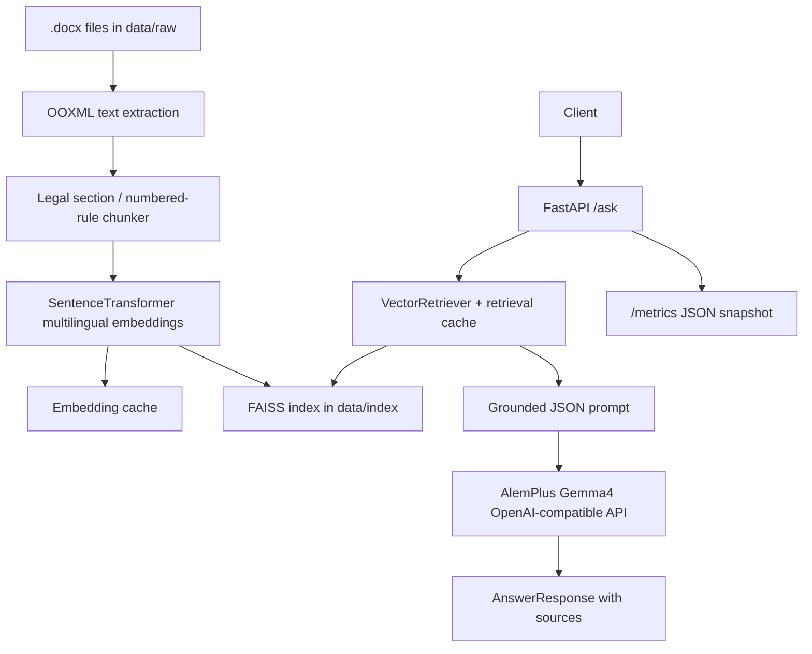

# AutoSphere RAG: Ассистент по правилам дорожного движения

## 1. What This Project Does
AutoSphere RAG is a FastAPI question-answering service for Kazakhstan road traffic rules and adjacent road legislation. It ingests `.docx` legal documents from `data/raw`, chunks them by legal sections and numbered rules, stores embeddings in FAISS, retrieves relevant passages for a user question, and asks an OpenAI-compatible LLM endpoint such as AlemPlus Gemma4 to produce a grounded JSON answer with citations.

## 2. Corpus and Licensing
- **Corpus:** Правила дорожного движения РК, Закон РК "О дорожном движении", КоАП РК fragments relevant to road offences, and compulsory motor liability insurance law.
- **Local files:** `data/raw/road_traffic_rules.docx`, `data/raw/road_traffic_law.docx`, `data/raw/code_of_administrative_offences.docx`, `data/raw/insurance_law.docx`.
- **Source:** public legal texts from Kazakhstan legal information portals such as `adilet.zan.kz`.
- **Use:** public normative legal acts are used for search and citation in an educational prototype. Check the official source before relying on an answer legally.

## 3. Quickstart
```bash
python -m venv venv && source venv/bin/activate
pip install -r requirements.txt
cp .env.example .env
```

Edit `.env` and set your AlemPlus values:

```bash
LLM_PROVIDER=alemplus
LLM_MODEL_NAME=gemma4
LLM_BASE_URL=https://llm.alem.ai/v1
LLM_API_KEY=your_api_key_here
RAG_PROVIDER=local
```

Then build the index and run the service:

```bash
make index
uvicorn app.main:app --port 8001
```

Example request:

```bash
curl -X POST http://localhost:8001/ask \
  -H "Content-Type: application/json" \
  -d '{"question":"Можно ли водителю пользоваться телефоном во время движения?", "top_k": 5}'
```

Example response shape:

```json
{
  "answer": "Ответ формируется только по найденным фрагментам документов.",
  "sources": [
    {
      "source_file": "road_traffic_rules.docx",
      "page": null,
      "section_title": "Глава 2. Общие обязанности водителей",
      "chunk_id": "road_traffic_rules.docx_sec_12"
    }
  ],
  "confidence": 0.82,
  "used_context": true
}
```

## 4. Architecture Diagram


## 5. Retrieval Quality
`evaluation/ground_truth.jsonl` should be refreshed with 15 hand-labeled traffic-rule questions after rebuilding `data/chunks.jsonl`, because chunk IDs are generated from the current corpus and chunking strategy.

| Configuration | Chunk Strategy | Recall@5 | MRR | nDCG@10 |
| :--- | :--- | :---: | :---: | :---: |
| Current target | Section and numbered-rule chunks | TBD after labeling | TBD | TBD |

Run:

```bash
python evaluation/evaluate_retrieval.py
```

## 6. Ablation Results
The implemented indexer supports the required recursive splitter and the production section-aware splitter. Use the same 15 labeled questions for a chunk-size sweep.

| Sweep | Expected Use | Recall@5 |
| :--- | :--- | :---: |
| Recursive 400 chars | baseline | TBD |
| Recursive 800 chars | longer context | TBD |
| Section-aware | production setting | TBD |

## 7. Latency and Cost Budget
- Retrieval uses local CPU embeddings and FAISS. Repeated identical queries use an in-memory retrieval cache.
- LLM cost depends on AlemPlus Gemma4 pricing and token usage. The service logs an approximate `token_usage` per request and exposes `total_tokens_consumed` at `/metrics`.
- Measure p50/p95 locally with repeated `/ask` calls after your `.env` is configured.

## 8. What Happens When It Breaks
1. **Missing or corrupt FAISS index:** `/ready` returns HTTP 503 and `/ask` rejects requests with `service not ready` instead of crashing. Re-run `make index`.
2. **AlemPlus timeout:** `app/reliability.py` bounds the LLM call and `app/main.py` returns HTTP 504 after configured retries.
3. **Malformed LLM JSON:** `app/generation.py` catches parse/validation failures and returns a controlled low-confidence fallback answer.
4. **Transient LLM HTTP errors:** `retry_with_backoff` retries the generation call with exponential backoff before surfacing the failure path.

## Useful Commands
```bash
make install
make index
make serve
make test
```

## RAGFlow Mode
RAGFlow is optional and should be treated as an external baseline, not as the primary RAID implementation. The default project path remains `RAG_PROVIDER=local`, using the repository's own ingestion, chunking, indexing, retrieval, evaluation hooks, FastAPI service, caching, and observability.

The app can also use RAGFlow as an experimental retrieval and generation backend instead of the built-in local retriever.

1. Upload the same traffic-law documents into a RAGFlow dataset.
2. Create a RAGFlow chat assistant over that dataset.
3. Copy the chat assistant ID and API key.
4. Set these variables in `.env`:

```bash
RAG_PROVIDER=ragflow
RAGFLOW_BASE_URL=https://YOUR_RAGFLOW_HOST
RAGFLOW_API_KEY=your_ragflow_api_key
RAGFLOW_CHAT_ID=your_chat_id
RAGFLOW_MODEL=gemma4
```

Then run:

```bash
uvicorn app.main:app --port 8001
```

Switch back to local retrieval by setting:

```bash
RAG_PROVIDER=local
```
