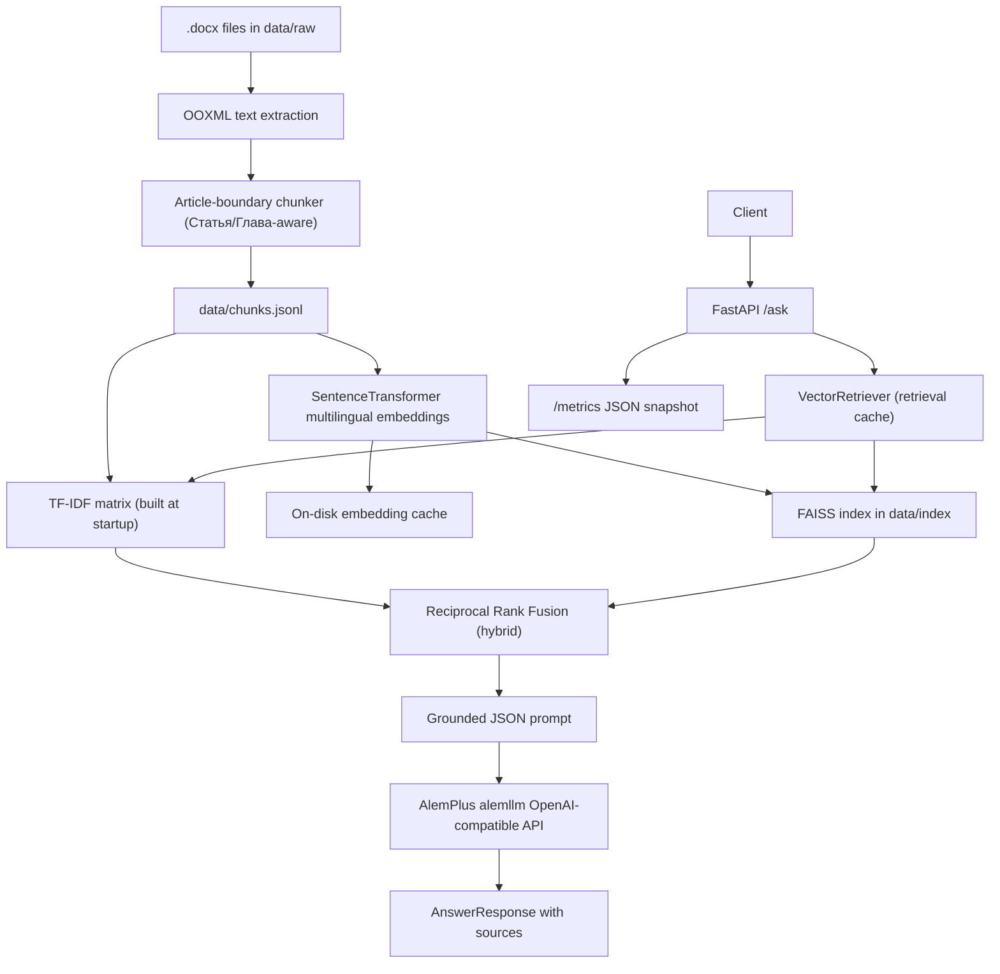

# AutoSphere RAG: Ассистент по правилам дорожного движения

## 1. What This Project Does
AutoSphere RAG is a FastAPI question-answering service for Kazakhstan road traffic rules and adjacent road legislation. It ingests `.docx` legal documents from `data/raw`, chunks them by article/Статья boundaries, indexes them with both TF-IDF and FAISS embeddings (combined via Reciprocal Rank Fusion), and asks an OpenAI-compatible LLM endpoint (AlemPlus `alemllm`, or any Ollama/OpenAI-compatible model) to produce a grounded JSON answer with citations.

## 2. Corpus and Licensing
- **Corpus:** Правила дорожного движения РК, Закон РК "О дорожном движении", КоАП РК fragments relevant to road offences, and compulsory motor liability insurance law.
- **Local files:** `data/raw/road_traffic_rules.docx`, `data/raw/road_traffic_law.docx`, `data/raw/code_of_administrative_offences.docx`, `data/raw/insurance_law.docx`.
- **Source:** public legal texts from Kazakhstan legal information portals such as `adilet.zan.kz`.
- **Use:** public normative legal acts are used for search and citation in an educational prototype. Check the official source before relying on an answer legally.

## 3. Quickstart
```bash
python -m venv venv && source venv/bin/activate
pip install -r requirements.txt
cp .env.example .env
```

Edit `.env` and set your AlemPlus values:

```bash
LLM_PROVIDER=alemplus
LLM_MODEL_NAME=alemllm
LLM_BASE_URL=https://llm.alem.ai/v1
LLM_API_KEY=your_api_key_here
RAG_PROVIDER=local
```

(`LLM_MODEL_NAME` must match a model your key is actually scoped to — a `key_model_access_denied` 401 means your key can't reach that model name; check `.env.example` for the note.)

Then build the index and run the service:

```bash
make index
uvicorn app.main:app --port 8000
```

Example request:

```bash
curl -X POST http://localhost:8000/ask \
  -H "Content-Type: application/json" \
  -d '{"question":"Можно ли водителю пользоваться телефоном во время движения?", "top_k": 5}'
```

Example response (captured from a live run against the AlemPlus `alemllm` endpoint):

```json
{
  "answer": "Водитель может пользоваться телефоном во время движения только посредством применения наушников или громкой связи.",
  "sources": [
    {
      "source_file": "code_of_administrative_offences.docx",
      "page": null,
      "section_title": "Статья 591. Пользование водителем при управлении транспортным средством телефоном либо радиостанцией",
      "chunk_id": "code_of_administrative_offences.docx_sec_707",
      "excerpt": null
    }
  ],
  "confidence": 1.0,
  "used_context": true
}
```

## 4. Architecture Diagram


`RETRIEVAL_BACKEND` selects the retrieval path: `lexical` (TF-IDF only), `embeddings` (FAISS only), or `hybrid` (RRF of both — default, see §6).

## 5. Retrieval Quality
`evaluation/ground_truth.jsonl` holds 15 hand-authored questions over the real corpus (`road_traffic_rules.docx`, `road_traffic_law.docx`, `code_of_administrative_offences.docx`, `insurance_law.docx`), each pointing at real `chunk_id`s in `data/chunks.jsonl`. The mix: 8 numeric-fact questions (fines, speed limits, deadlines, sums), 5 definition questions, 2 multi-chunk questions that require combining two sections (one within a single document, one across ПДД + КоАП).

| Backend (`RETRIEVAL_BACKEND`) | Recall@5 | MRR | nDCG@10 |
| :--- | :---: | :---: | :---: |
| `lexical` (TF-IDF only) | 0.500 | 0.465 | 0.504 |
| `embeddings` (FAISS only) | 0.833 | 0.682 | 0.709 |
| **`hybrid`** (weighted RRF, default) | **0.900** | 0.717 | 0.753 |

Run:

```bash
RETRIEVAL_BACKEND=hybrid python evaluation/evaluate_retrieval.py
```

## 6. Ablation Results
**Retrieval strategy comparison (pure lexical vs pure vector vs hybrid RRF)**, same corpus, same 15-question ground truth, chunking held fixed (article-boundary chunker, §"Chunking" ADR):

| Strategy | Recall@5 | MRR | nDCG@10 |
| :--- | :---: | :---: | :---: |
| TF-IDF lexical (plain cosine, no keyword boosting) | 0.500 | 0.465 | 0.504 |
| FAISS embeddings (`paraphrase-multilingual-MiniLM-L12-v2`) | 0.833 | 0.682 | 0.709 |
| Hybrid (weighted Reciprocal Rank Fusion, 0.3 lexical / 0.7 embeddings, k=60) | **0.900** | 0.717 | 0.753 |

Plain TF-IDF cosine similarity is the weakest signal here (0.500) — legal Russian text has heavy morphology (падежи/spelling variants) that word-level TF-IDF doesn't normalize, and several ground-truth questions are paraphrased definitions ("что означает термин...") that share little surface vocabulary with the source article. FAISS embeddings alone do much better (0.833) because the multilingual sentence model captures semantic similarity past the vocabulary mismatch. Weighted RRF of the two (0.900) beats either signal alone on every metric (MRR 0.717, nDCG@10 0.753 — both higher than embeddings-only), because it recovers hits neither ranker gets fully right alone.

These numbers include a chunking fix and a retrieval-fusion fix, found in that order, each caught by actually running the service rather than trusting the eval script alone:

1. **Chunking** (see `docs/adr/001-chunking.md`): the first pass at this ablation (chunking held at "one chunk per Статья/Пункт") got hybrid to only 0.767, with three definition questions ("уступить дорогу", "пешеходный переход", "дорожное движение") failing under *every* backend, because ПДД's "Основные понятия" glossary section packed dozens of unrelated terms into the same ~1,600-char chunk. Splitting it into one chunk per defined term (`scripts/build_index.py::split_glossary_by_term`) fixed all three with zero retrieval-code changes — recall@5 went 0.767 to 0.967 on the ground truth.
2. **RRF weighting** (see `docs/adr/002-retrieval-fusion.md`): that 0.967 number used *unweighted* RRF over a candidate pool that scaled with `top_k` — two compounding bugs. Manually asking the live service a realistic, colloquial question ("я выпил алкоголь за рулем, если остановят, то какие последствия?" — phrased nothing like the ground truth) returned a completely unrelated answer about overtaking rules. Root cause: TF-IDF found no vocabulary match and produced near-noise rankings for this query, yet unweighted RRF let a chunk that was merely mediocre in *both* signals outscore the chunk FAISS correctly ranked first (because TF-IDF happened to rank it just outside a truncated 100-item candidate pool). Fixed by (a) ranking the full corpus in both signals — cheap at this corpus size, and removes candidate-pool truncation as a failure mode entirely — and (b) weighting embeddings 0.7 vs. lexical 0.3 in the RRF sum, since embeddings is the more reliable signal on this corpus generally (0.833 vs. 0.500 alone). This traded 3 points of ground-truth recall@5 (0.967 to 0.900 — one formal definition question, "уступить дорогу", regressed because lexical genuinely was the better signal for that specific query) for fixing a realistic query that was flatly broken. MRR and nDCG@10 both improved, so it wasn't a strict downgrade even on the formal set.

The one remaining ground-truth gap (query 15, recall 0.5) is a deliberately hard multi-chunk question spanning two different documents (ПДД §12 + КоАП Статья 608) — each retriever ranks chunks independently, so a question whose answer needs two chunks from different parts of the corpus is inherently harder than a single-chunk lookup, regardless of strategy.

**A prefix-consistency note, worth recording separately:** `evaluation/evaluate_retrieval.py` always calls `retrieve(question, top_k=10)` and computes recall@5 by slicing the first 5 results — valid only if `retrieve(q, top_k=5)` is guaranteed to return the same first 5 items as `retrieve(q, top_k=10)`. Ranking the full corpus (rather than a `top_k`-scaled candidate pool) in both signals guarantees this by construction, since `top_k` now only truncates the final fused list — it no longer changes which candidates get ranked in the first place.

**Known limitation, deliberately left unfixed (see `docs/adr/002-retrieval-fusion.md`):** questions whose answer requires bridging vocabulary that never co-occurs in the corpus still fail. "Что будет если проехать на оранжевый светофор?" needs three separate provisions across two documents (what a yellow signal means, the stop rule, and the КоАП fine article) that never share the word "оранжевый" — the fine article ranks 766th under TF-IDF and 66th under embeddings for this query, well outside any practical `top_k`. Fixing this properly needs query rewriting (reformulating the colloquial question into legal terminology via the LLM before retrieval), which is a real architecture change — an added LLM call in the critical path — and was intentionally not implemented in this pass.

## 7. Latency and Cost Budget
Measured against the live AlemPlus `alemllm` endpoint, 15 ground-truth questions, `RETRIEVAL_BACKEND=hybrid`, on a MacBook CPU (embeddings on `mps`, no GPU required):

| Stage | p50 | p95 |
| :--- | :---: | :---: |
| Retrieval (TF-IDF + FAISS + RRF) | <1 ms | ~500 ms (cold, first query only — model/tfidf warm-up) |
| Generation (LLM call) | 801 ms | 1092 ms |
| **Total, cache miss** | **882 ms** | **1145 ms** |
| **Total, cache hit** (repeat query) | **802 ms** | **1075 ms** |

The retrieval cache barely moves total latency (≈6% p95 improvement) because retrieval itself is already sub-millisecond on this corpus size (2,719 chunks) — the LLM call dominates end-to-end latency, so a **response cache** (keyed on the full question, not just retrieval) would have far more impact than the current retrieval-only cache. That's a documented trade-off, not an oversight: a response cache needs an invalidation strategy (see `docs/adr/` — the retrieval cache's `index_version` bump is sufficient today because the index rarely changes; a response cache would need the same plus a TTL for LLM non-determinism).

**Cost:** `/metrics` reports `total_tokens_consumed`; across the 15-question run this averaged **~850 tokens/request** (question + up to 5 retrieved chunks + system prompt + answer). At that rate, 1,000 questions ≈ 850K tokens. Converting to a dollar figure requires AlemPlus's published per-token rate, which isn't available to this project — the token count itself is the honest, portable number to defend; multiply by whatever rate card applies to your account.

## 8. What Happens When It Breaks
1. **Missing or corrupt FAISS/TF-IDF index:** `/ready` returns HTTP 503 and `/ask` rejects requests with `{"detail": "The vector search engine is not ready."}` instead of crashing. Re-run `make index`.
2. **AlemPlus timeout:** `app/reliability.py` bounds the LLM call at `LLM_TIMEOUT_SECONDS` (default 30s) and `app/main.py` returns HTTP 504 with `{"detail": "LLM generation timed out. Please try again."}` after `MAX_RETRIES` retry attempts (1s → 2s → 4s backoff) are exhausted.
3. **Malformed or fenced LLM JSON:** observed in practice — the AlemPlus `alemllm` model sometimes wraps its JSON reply in a ` ```json ... ``` ` markdown fence despite the system prompt explicitly forbidding it. `app/generation.py::strip_json_fence` strips the fence before parsing; if parsing still fails (`json.loads` raises), the service falls back to a low-confidence answer (`confidence: 0.0, used_context: false`) instead of a 500. This is the failure mode most likely to recur in production, since it depends on upstream model behavior outside our control.
4. **Transient LLM HTTP errors:** `retry_with_backoff` retries the generation call up to `MAX_RETRIES` times with exponential backoff before surfacing HTTP 504/502.
5. **Vector search unreachable:** `VectorRetriever.retrieve()` raises `DatabaseConnectionError`, which `app/main.py` catches and returns HTTP 503 with an honest message rather than a stack trace.

## Useful Commands
```bash
make install
make index
make serve
make test
```

## RAGFlow Mode
RAGFlow is optional and should be treated as an external baseline, not as the primary RAID implementation. The default project path remains `RAG_PROVIDER=local`, using the repository's own ingestion, chunking, indexing, retrieval, evaluation hooks, FastAPI service, caching, and observability.

The app can also use RAGFlow as an experimental retrieval and generation backend instead of the built-in local retriever.

1. Upload the same traffic-law documents into a RAGFlow dataset.
2. Create a RAGFlow chat assistant over that dataset.
3. Copy the chat assistant ID and API key.
4. Set these variables in `.env`:

```bash
RAG_PROVIDER=ragflow
RAGFLOW_BASE_URL=https://YOUR_RAGFLOW_HOST
RAGFLOW_API_KEY=your_ragflow_api_key
RAGFLOW_CHAT_ID=your_chat_id
RAGFLOW_MODEL=gemma4
```

Then run:

```bash
uvicorn app.main:app --port 8000
```

Switch back to local retrieval by setting:

```bash
RAG_PROVIDER=local
```
