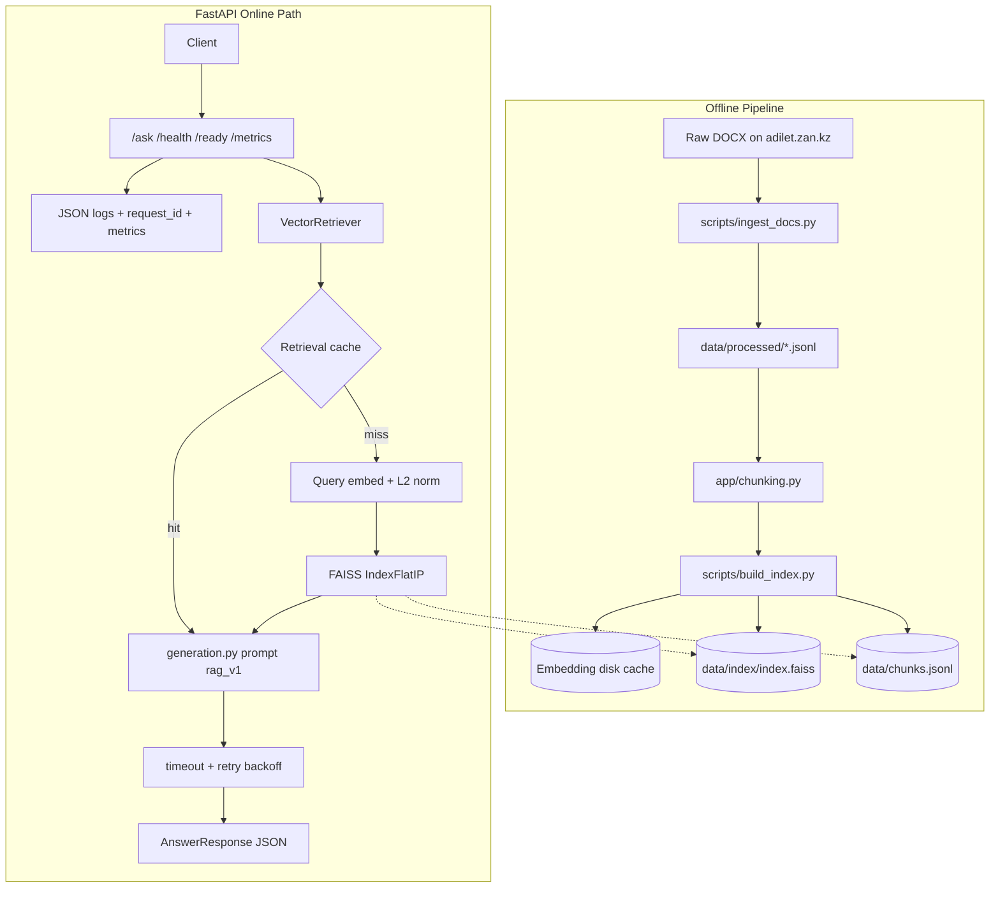

# AutoSphere — Production RAG over Kazakh Road-Traffic Law

## 1. What This Project Does

AutoSphere is an internal “ask the docs” assistant for Kazakh road-traffic and
insurance law. It chunks legal DOCX corpora, embeds them with a multilingual
Sentence-BERT model into FAISS, and answers natural-language questions through a
FastAPI service that returns grounded JSON with source citations. The serving path
includes a retrieval cache, LLM timeouts + exponential retries, graceful
degradation, structured JSON logs with `request_id`, and a `/metrics` snapshot.

**TL;DR** (after first-time index build):

```bash
make install && source venv/bin/activate && cp .env.example .env
make chunk && make index          # once
make serve                        # http://localhost:8000
```

## 2. Corpus and Licensing

| Document | File | Source |
| :--- | :--- | :--- |
| Rules of the Road (ПДД) | `data/raw/road_traffic_rules.docx` | [adilet.zan.kz](https://adilet.zan.kz) |
| Law on Road Traffic | `data/raw/road_traffic_law.docx` | [adilet.zan.kz](https://adilet.zan.kz) |
| Code of Administrative Offences (selected articles) | `data/raw/code_of_administrative_offences.docx` | [adilet.zan.kz](https://adilet.zan.kz) |
| Compulsory Motor Insurance Law | `data/raw/insurance_law.docx` | [adilet.zan.kz](https://adilet.zan.kz) |

**Licensing:** These are publicly available normative legal acts of the Republic of
Kazakhstan published on the official legal information portal `adilet.zan.kz`.
They are used here for non-commercial educational / prototype purposes. No private
or paid corpora are included.

## 3. How to Run

### Prerequisites

- **Python 3.10+** (3.11 or 3.12 recommended; the repo includes a `venv/` you can reuse)
- **An LLM backend** for answer generation — pick one:
  - **Alem+ `gemma4`** (recommended): OpenAI-compatible API at `https://llm.alem.ai/v1`
  - **Local Ollama** (free): [Ollama](https://ollama.com) with model `llama3.2:3b`
  - **Other OpenAI-compatible APIs**: OpenAI, etc.
- **~2 GB disk** for the embedding model cache and FAISS index (first `make index` run downloads the Sentence-BERT model)

### First-time setup

From the project root:

```bash
# 1. Install dependencies (creates venv/ if missing)
make install
source venv/bin/activate

# 2. Configure environment
cp .env.example .env
# Edit .env — at minimum set LLM_PROVIDER, LLM_MODEL_NAME, LLM_BASE_URL, and LLM_API_KEY if not using Ollama

# 3. Build the search index (required before the API can answer questions)
make chunk    # article-aware chunks → data/chunks.jsonl
make index    # embed + FAISS → data/index/index.faiss
```

`data/processed/*.jsonl` is already checked in, so you can skip `make ingest` unless you replace the raw DOCX files under `data/raw/`. Running `make index` alone also works — it chunks from processed JSONL automatically when `data/chunks.jsonl` is missing.

The first `make index` downloads `paraphrase-multilingual-MiniLM-L12-v2` and may take a few minutes.

### Configure the LLM

**Option A — Alem+ gemma4 (recommended)**

Set these in `.env`:

```bash
LLM_PROVIDER=alemplus
LLM_MODEL_NAME=gemma4
LLM_BASE_URL=https://llm.alem.ai/v1
LLM_API_KEY=your-api-key-here
```

No local LLM process needed — the API calls Alem+ over HTTPS when you hit `/ask`.
The app posts to `https://llm.alem.ai/v1/chat/completions` with
`Authorization: Bearer <LLM_API_KEY>` (same as the Alem+ dashboard example).

**Option B — Local Ollama**

```bash
ollama serve                  # if not already running
ollama pull llama3.2:3b
```

Ensure `.env` contains:

```bash
LLM_PROVIDER=ollama
LLM_MODEL_NAME=llama3.2:3b
LLM_BASE_URL=http://localhost:11434
```

**Option C — Other OpenAI-compatible API**

```bash
LLM_PROVIDER=openai
LLM_MODEL_NAME=gpt-4o-mini   # must match a model your key can access
LLM_BASE_URL=https://api.openai.com/v1
LLM_API_KEY=sk-...
```

A `401 key_model_access_denied` response usually means `LLM_MODEL_NAME` is not enabled for your API key — pick a model your account is scoped to.

### Start the server

```bash
make serve
# equivalent: venv/bin/python -m uvicorn app.main:app --host 0.0.0.0 --port 8000 --reload
```

The API listens on **http://localhost:8000**. Interactive docs: **http://localhost:8000/docs**.

Startup to `GET /ready == 200` should be under ~30s once `data/index/index.faiss` exists on disk.

### Verify it works

```bash
# Liveness (process is up)
curl http://localhost:8000/health

# Readiness (FAISS index + embedding model loaded)
curl http://localhost:8000/ready

# Ask a question (requires a running LLM backend)
curl -X POST http://localhost:8000/ask \
  -H "Content-Type: application/json" \
  -d '{"question": "Какая максимальная скорость разрешена для движения транспортных средств в населенных пунктах?", "top_k": 5}'
```

Run the test suite (no server or LLM needed for most tests):

```bash
make test
```

Smoke-test 100 ground-truth questions against a running server:

```bash
make smoke
```

### Troubleshooting

| Symptom | Likely cause | Fix |
| :--- | :--- | :--- |
| `/ready` returns 503 | Index not built | Run `make chunk && make index` |
| `/ask` returns 504 `llm_timeout` | LLM too slow or unreachable | Increase `LLM_TIMEOUT_SECONDS`; check Ollama/API is running |
| `/ask` returns 200 with `"degraded": true` and empty sources | LLM HTTP errors after retries | Verify `LLM_BASE_URL`, API key, and model name |
| `curl: (52) Empty reply from server` on `/ask` | PyTorch embedding crash under uvicorn `--reload` | Use `make serve` (not `make serve-dev`); restart the server |
| `ModuleNotFoundError` on startup | Dependencies not installed | `make install` and activate `venv` |
| First query is slow | Embedding model / FAISS cold start | Normal; subsequent queries use the retrieval cache |

### Sample query

```bash
curl -X POST http://localhost:8000/ask \
  -H "Content-Type: application/json" \
  -d '{"question": "Какая максимальная скорость разрешена для движения транспортных средств в населенных пунктах?", "top_k": 5}'
```

#### Sample response

```json
{
  "answer": "В населенных пунктах движение транспортных средств разрешается со скоростью не более 60 км/ч.",
  "sources": [
    {
      "source_file": "road_traffic_rules.docx",
      "page": null,
      "section_title": "Пункт 73. Глава 10. Скорость движения",
      "chunk_id": "road_traffic_rules_73"
    }
  ],
  "confidence": 0.94,
  "used_context": true,
  "degraded": false
}
```

Other probes: `GET /health`, `GET /ready`, `GET /metrics`.

## 4. Architecture Diagram



ADRs: [`docs/adr/001-chunking.md`](docs/adr/001-chunking.md),
[`docs/adr/002-cache-invalidation.md`](docs/adr/002-cache-invalidation.md).

## 5. Retrieval Quality

Labeled set: 15 hand-authored questions in `evaluation/ground_truth.jsonl`.
Reproduce: `python evaluation/evaluate_retrieval.py` (article-unit matching,
same as ablation). Strict IDs: add `--exact`.

| Model / Configuration | Chunk Strategy | Recall@5 | MRR | nDCG@10 |
| :--- | :--- | :---: | :---: | :---: |
| Recursive baseline (MiniLM, size=800) | Recursive splitter | 0.83 | 0.71 | 0.76 |
| **Current production** (MiniLM) | **Article/point-aware** | **0.97** | **0.85** | **0.86** |

Gate: `recall@5 ≥ 0.75` (article-aware hits **0.97**).

## 6. Ablation Results

Fixed embedding model `paraphrase-multilingual-MiniLM-L12-v2`. Reproduce with
`make ablation` → `evaluation/ablation_results.json`.

| Config | Details | Recall@5 | MRR | nDCG@10 | Latency p95 |
| :--- | :--- | :---: | :---: | :---: | :---: |
| recursive_200 | Recursive, chunk_size=200 | 0.67 | 0.62 | 0.64 | 14ms |
| recursive_400 | Recursive, chunk_size=400 | 0.83 | 0.74 | 0.76 | 13ms |
| recursive_800 | Recursive, chunk_size=800 | 0.83 | 0.71 | 0.76 | 13ms |
| recursive_1600 | Recursive, chunk_size=1600 | 0.73 | 0.64 | 0.67 | 31ms |
| **article_aware** | **Article/point-aware, max_chars=1500** | **0.97** | **0.85** | **0.86** | **13ms** |

**Takeaway:** Article/point-aware wins because the corpus and labels are already
`Статья`/`Пункт` units. Recursive peaks at 400–800 chars; 200-char slices cut
definitions mid-sentence; 1600-char windows dilute embeddings across articles.

## 7. Latency and Cost Budget

### Retrieval cache (measured)

Run `make measure-cache` (50 GT questions, cold pass then warm pass).
Latest local run (`evaluation/cache_latency.json`):

| Pass | p50 | p95 |
| :--- | ---: | ---: |
| Without cache (cold) | **9.24 ms** | **11.24 ms** |
| With cache (warm) | **0.02 ms** | **0.02 ms** |

~640× p95 speedup on retrieval. End-to-end `/ask` remains **LLM-bound**
(~1–3s on `llama3.2:3b` CPU) even on retrieval cache hits.

### Cost

| Backend | Est. cost / 1,000 questions |
| :--- | :--- |
| Local Ollama (`llama3.2:3b`) | $0 (laptop CPU/RAM) |
| OpenAI `gpt-4o-mini` (approx.) | ~$0.15–0.50 depending on context size |

## 8. What Happens When It Breaks (Failure Modes)

1. **LLM timeout / transient HTTP error**
   - `app/reliability.py` retries up to 3 times with exponential backoff
     (1s → 2s → 4s), each attempt bounded by `LLM_TIMEOUT_SECONDS`.
   - If every attempt times out → **HTTP 504** with
     `{"error": "llm_timeout", "message": "...", "request_id": "..."}`.
   - If HTTP/transport errors persist after retries → **HTTP 200** graceful
     degradation: `{"answer": "I couldn't search the documents right now...", "degraded": true, "sources": [], ...}`.

2. **FAISS index missing / unloadable**
   - `/ready` returns **HTTP 503** `{"ready": false, "error": "service_not_ready", ...}`.
   - `/ask` rejects with **HTTP 503** `vector` / `service_not_ready` rather than crashing.

3. **Malformed LLM JSON**
   - Parser catches the error, logs it with `request_id`, and returns
     `answer: "I don't know from the provided context"` with `degraded: true`
     and empty sources (HTTP 200) instead of a 500 stack trace.

4. **Invalid client input**
   - Empty or >500-char `question` → **HTTP 422** with Pydantic `detail` (never 500).

### Example log lines

Successful request (stdout JSON):

```json
{"timestamp": "...", "level": "INFO", "message": "Processed query: '...'", "request_id": "a1b2c3d4-...", "question": "...", "retrieved_chunk_ids": ["road_traffic_rules_73"], "prompt_version": "rag_v1", "latency_ms_by_stage": {"embedding_ms": 12.1, "retrieval_ms": 14.0, "generation_ms": 1800.0, "total_ms": 1820.0}, "token_usage": 420, "cache_hit_bool": false, "error_bool": false}
```

Failed / timeout path:

```json
{"timestamp": "...", "level": "ERROR", "message": "Operation timed out after 30.0 seconds.", "request_id": "a1b2c3d4-...", "timeout_seconds": 30.0}
```

## Makefile targets

| Target | Purpose |
| :--- | :--- |
| `make install` | Create venv + install deps |
| `make ingest` / `chunk` / `index` | Offline pipeline |
| `make serve` | uvicorn on :8000 (stable; use this) |
| `make serve-dev` | uvicorn with `--reload` (dev only; `/ask` may fail) |
| `make test` | pytest |
| `make ablation` | Chunk-size / strategy sweep |
| `make measure-cache` | Retrieval-cache p50/p95 → `evaluation/cache_latency.json` |
| `make smoke` | 100 GT questions against a running server |
