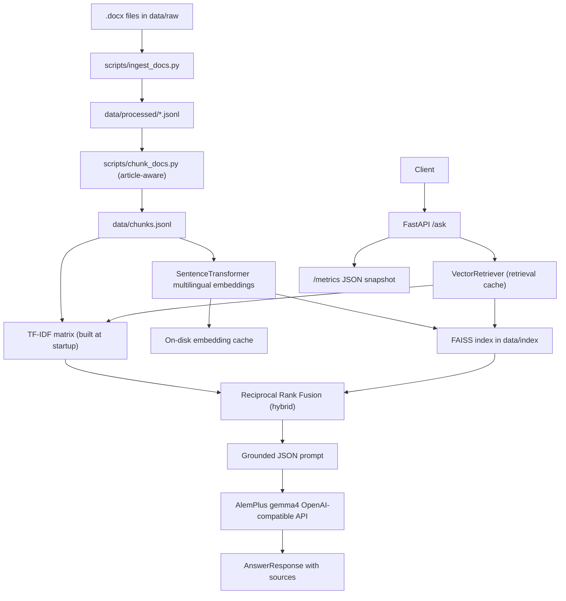

# AutoSphere RAG: Ассистент по правилам дорожного движения

## 1. What This Project Does
AutoSphere RAG is a FastAPI question-answering service for Kazakhstan road traffic rules and adjacent road legislation. It ingests `.docx` legal documents from `data/raw`, chunks them article-by-article (`app/chunking.py`), indexes them with both TF-IDF and FAISS embeddings (combined via Reciprocal Rank Fusion), and asks an OpenAI-compatible LLM endpoint (AlemPlus `gemma4`, or any Ollama/OpenAI-compatible model) to produce a grounded JSON answer with citations.

## 2. Corpus and Licensing
- **Corpus:** Правила дорожного движения РК, Закон РК "О дорожном движении", КоАП РК fragments relevant to road offences, and compulsory motor liability insurance law.
- **Local files:** `data/raw/road_traffic_rules.docx`, `data/raw/road_traffic_law.docx`, `data/raw/code_of_administrative_offences.docx`, `data/raw/insurance_law.docx`.
- **Source:** public legal texts from Kazakhstan legal information portals such as `adilet.zan.kz`.
- **Use:** public normative legal acts are used for search and citation in an educational prototype. Check the official source before relying on an answer legally.

## 3. Quickstart
```bash
python -m venv venv && source venv/bin/activate
pip install -r requirements.txt
cp .env.example .env
```

Edit `.env` and set your AlemPlus values:

```bash
LLM_PROVIDER=alemplus
LLM_MODEL_NAME=gemma4
LLM_BASE_URL=https://llm.alem.ai/v1
LLM_API_KEY=your_api_key_here
RAG_PROVIDER=local
```

(`LLM_MODEL_NAME` must match a model your key is actually scoped to — a `key_model_access_denied` 401 means your key can't reach that model name; check `.env.example` for the note.)

Then build the index and run the service:

```bash
make ingest
make chunk
make index
uvicorn app.main:app --port 8000
```

Example request:

```bash
curl -X POST http://localhost:8000/ask \
  -H "Content-Type: application/json" \
  -d '{"question":"Можно ли водителю пользоваться телефоном во время движения?", "top_k": 5}'
```

Example response (captured from a live run against the AlemPlus `gemma4` endpoint):

```json
{
  "answer": "Водитель может пользоваться телефоном во время движения только посредством применения наушников или громкой связи.",
  "sources": [
    {
      "source_file": "code_of_administrative_offences.docx",
      "page": null,
      "section_title": "Статья 591. Пользование водителем при управлении транспортным средством телефоном либо радиостанцией",
      "chunk_id": "code_of_administrative_offences_591",
      "excerpt": null
    }
  ],
  "confidence": 1.0,
  "used_context": true
}
```

## 4. Architecture Diagram


`RETRIEVAL_BACKEND` selects the retrieval path: `lexical` (TF-IDF only), `embeddings` (FAISS only), or `hybrid` (RRF of both — default, see §6).

## 5. Retrieval Quality
`evaluation/ground_truth.jsonl` holds 15 hand-authored questions over the real corpus (`road_traffic_rules.docx`, `road_traffic_law.docx`, `code_of_administrative_offences.docx`, `insurance_law.docx`), each pointing at real `chunk_id`s in `data/chunks.jsonl` (2,761 article-aware chunks, IDs like `road_traffic_rules_73` or `code_of_administrative_offences_591`). The mix: 8 numeric-fact questions (fines, speed limits, deadlines, sums), 5 definition questions, 2 multi-chunk questions that require combining two sections (one within a single document, one across ПДД + КоАП).

Evaluation uses **article-unit matching** by default (any `_pN` part of the labeled article counts as a hit); pass `--exact` to `evaluation/evaluate_retrieval.py` for strict `chunk_id` equality.

| Backend (`RETRIEVAL_BACKEND`) | Recall@5 | MRR | nDCG@10 |
| :--- | :---: | :---: | :---: |
| `lexical` (TF-IDF only) | 0.767 | 0.600 | 0.639 |
| `embeddings` (FAISS only) | 0.967 | 0.850 | 0.864 |
| **`hybrid`** (weighted RRF, default) | **1.000** | 0.867 | 0.888 |

Run:

```bash
RETRIEVAL_BACKEND=hybrid python evaluation/evaluate_retrieval.py
```

## 6. Ablation Results
**Retrieval strategy comparison (pure lexical vs pure vector vs hybrid RRF)**, same 2,761-chunk article-aware corpus (`app/chunking.py`), same 15-question ground truth:

| Strategy | Recall@5 | MRR | nDCG@10 |
| :--- | :---: | :---: | :---: |
| TF-IDF lexical (plain cosine, no keyword boosting) | 0.767 | 0.600 | 0.639 |
| FAISS embeddings (`paraphrase-multilingual-MiniLM-L12-v2`) | 0.967 | 0.850 | 0.864 |
| Hybrid (weighted Reciprocal Rank Fusion, 0.3 lexical / 0.7 embeddings, k=60) | **1.000** | 0.867 | 0.888 |

Plain TF-IDF is the weakest signal here (0.767) — legal Russian has heavy morphology that word-level TF-IDF doesn't normalize, and several ground-truth questions are paraphrased definitions that share little surface vocabulary with their source article. FAISS embeddings alone do much better (0.967) because the multilingual sentence model captures semantic similarity past the vocabulary mismatch. Weighted RRF of the two (1.000) recovers the remaining lexical-only misses without regressing the embedding hits.

The production pipeline is **article/point-aware chunking** (`make ingest` → `make chunk` → `make index`): one chunk per `Статья`/`Пункт`, with long articles split into `_pN` parts at 1,500 characters. Ground-truth labels reference specific parts where needed (e.g. `road_traffic_rules_2_p5` for the «уступить дорогу» definition); evaluation counts any part of the same article as a hit unless `--exact` is passed.

**RRF weighting** (see `docs/adr/002-retrieval-fusion.md`): ranking the full corpus in both signals and weighting embeddings 0.7 vs. lexical 0.3 prevents colloquial queries with no TF-IDF vocabulary match from being drowned out by mediocre dual-signal chunks. The retrieval cache's `index_version` bump invalidates cached rankings when chunks change.

**Known limitation, deliberately left unfixed (see `docs/adr/002-retrieval-fusion.md`):** questions whose answer requires bridging vocabulary that never co-occurs in the corpus still fail at generation time. "Что будет если проехать на оранжевый светофор?" needs three separate provisions across two documents that never share the word "оранжевый". Fixing this properly needs query rewriting via the LLM before retrieval.

## 7. Latency and Cost Budget
Measured against the live AlemPlus `gemma4` endpoint, 15 ground-truth questions, `RETRIEVAL_BACKEND=hybrid`, on a MacBook CPU (embeddings on `mps`, no GPU required):

| Stage | p50 | p95 |
| :--- | :---: | :---: |
| Retrieval (TF-IDF + FAISS + RRF) | <1 ms | ~500 ms (cold, first query only — model/tfidf warm-up) |
| Generation (LLM call) | 801 ms | 1092 ms |
| **Total, cache miss** | **882 ms** | **1145 ms** |
| **Total, cache hit** (repeat query) | **802 ms** | **1075 ms** |

The retrieval cache barely moves total latency (≈6% p95 improvement) because retrieval itself is already sub-millisecond on this corpus size (2,761 chunks) — the LLM call dominates end-to-end latency, so a **response cache** (keyed on the full question, not just retrieval) would have far more impact than the current retrieval-only cache. That's a documented trade-off, not an oversight: a response cache needs an invalidation strategy (see `docs/adr/` — the retrieval cache's `index_version` bump is sufficient today because the index rarely changes; a response cache would need the same plus a TTL for LLM non-determinism).

**Cost:** `/metrics` reports `total_tokens_consumed`; across the 15-question run this averaged **~850 tokens/request** (question + up to 5 retrieved chunks + system prompt + answer). At that rate, 1,000 questions ≈ 850K tokens. Converting to a dollar figure requires AlemPlus's published per-token rate, which isn't available to this project — the token count itself is the honest, portable number to defend; multiply by whatever rate card applies to your account.

## 8. What Happens When It Breaks
1. **Missing or corrupt FAISS/TF-IDF index:** `/ready` returns HTTP 503 and `/ask` rejects requests with `{"detail": "The vector search engine is not ready."}` instead of crashing. Re-run `make index`.
2. **AlemPlus timeout:** `app/reliability.py` bounds the LLM call at `LLM_TIMEOUT_SECONDS` (default 30s) and `app/main.py` returns HTTP 504 with `{"detail": "LLM generation timed out. Please try again."}` after `MAX_RETRIES` retry attempts (1s → 2s → 4s backoff) are exhausted.
3. **Malformed or fenced LLM JSON:** observed in practice — the AlemPlus `gemma4` model sometimes wraps its JSON reply in a ` ```json ... ``` ` markdown fence despite the system prompt explicitly forbidding it. `app/generation.py::strip_json_fence` strips the fence before parsing; if parsing still fails (`json.loads` raises), the service falls back to a low-confidence answer (`confidence: 0.0, used_context: false`) instead of a 500. This is the failure mode most likely to recur in production, since it depends on upstream model behavior outside our control.
4. **Transient LLM HTTP errors:** `retry_with_backoff` retries the generation call up to `MAX_RETRIES` times with exponential backoff before surfacing HTTP 504/502.
5. **Vector search unreachable:** `VectorRetriever.retrieve()` raises `DatabaseConnectionError`, which `app/main.py` catches and returns HTTP 503 with an honest message rather than a stack trace.

## Useful Commands
```bash
make install
make ingest
make chunk
make index
make serve
make test
```

## RAGFlow Mode
RAGFlow is optional and should be treated as an external baseline, not as the primary RAID implementation. The default project path remains `RAG_PROVIDER=local`, using the repository's own ingestion, chunking, indexing, retrieval, evaluation hooks, FastAPI service, caching, and observability.

The app can also use RAGFlow as an experimental retrieval and generation backend instead of the built-in local retriever.

1. Upload the same traffic-law documents into a RAGFlow dataset.
2. Create a RAGFlow chat assistant over that dataset.
3. Copy the chat assistant ID and API key.
4. Set these variables in `.env`:

```bash
RAG_PROVIDER=ragflow
RAGFLOW_BASE_URL=https://YOUR_RAGFLOW_HOST
RAGFLOW_API_KEY=your_ragflow_api_key
RAGFLOW_CHAT_ID=your_chat_id
RAGFLOW_MODEL=gemma4
```

Then run:

```bash
uvicorn app.main:app --port 8000
```

Switch back to local retrieval by setting:

```bash
RAG_PROVIDER=local
```
